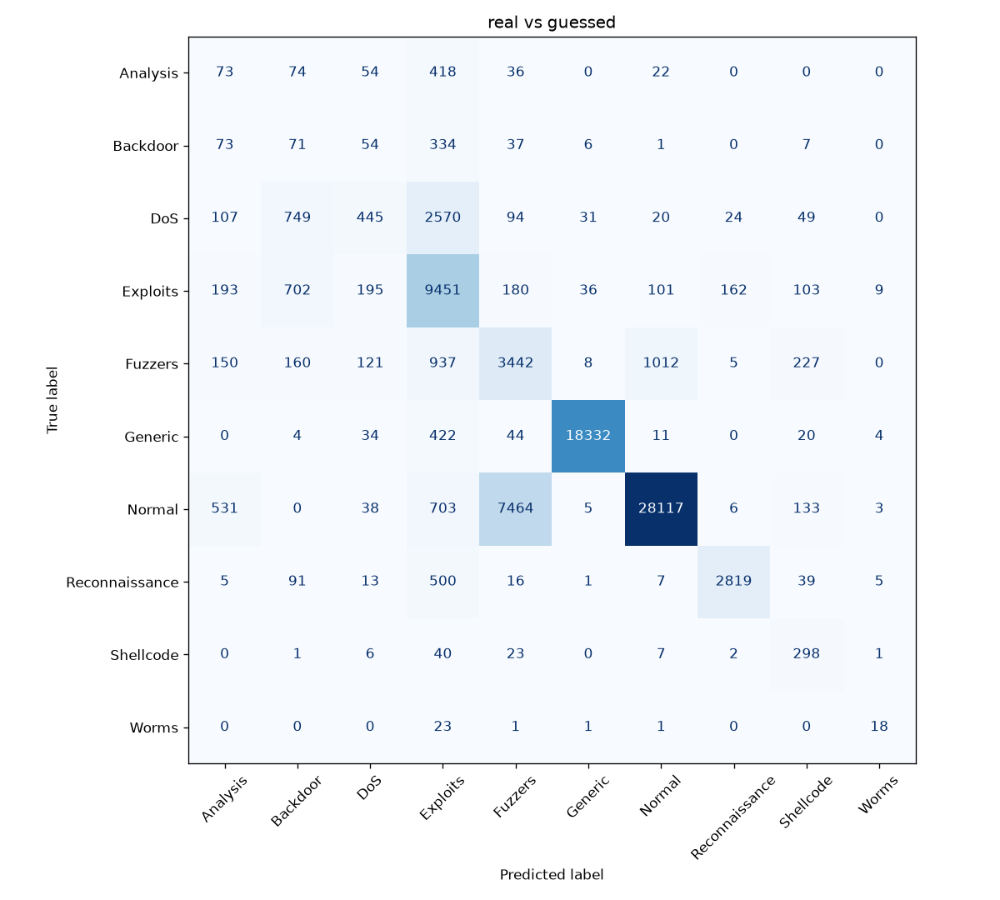
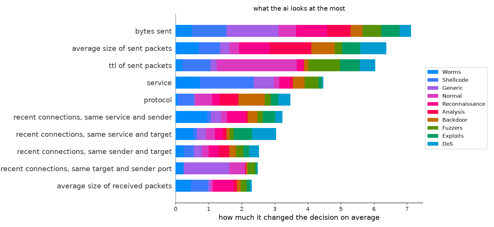

# idsExplainer

small ids (intrusion detection system) that sorts network connections into normal or one of 9 attack types and uses shap to show why it decided that

trained with xgboost on the [UNSW-NB15](https://research.unsw.edu.au/projects/unsw-nb15-dataset) dataset, so it works on recorded traffic and not live

## run it

```
pip install -r requirements.txt
python live.py      # random test connections with the 3 main reasons
python overview.py  # how often each attack is guessed right
python plots.py     # makes the two pictures below
python train.py     # trains model.ubj again
```

## example

```
Fuzzers          72.7%  ##################### <- ai
Normal           22.1%  ###### <- real

why Fuzzers?
  for      tcp setup time part 1: 0.041352
  for      ttl of sent packets: 254
  for      bytes sent: 546
```

## results

76.6% right overall, but it depends a lot on the attack



rows are the real attack, columns what the model guessed, everything on the diagonal is right



average shap value over 3000 connections, longer bar = the model relies more on that feature, colors show for which attack

## things i noticed

- DoS gets guessed as Exploits most of the time (2570 of 4089), Analysis and Backdoor too. the model can barely tell them apart
- 20% of normal connections get flagged as Fuzzers (7464 of 37000), thats a lot of false alarms
- Worms only has 130 examples to learn from (Normal has 56000) and only 41% get recognised
- "ttl of sent packets" is the 3rd most important feature, mostly for deciding Normal. in the training data 70% of normal connections have ttl 31 and not a single attack does, almost all attacks have 254 or 62. thats probably just how the dataset was recorded and not how real attacks look, so the model learned a shortcut. the example above is a normal connection that got flagged partly because of ttl 254
